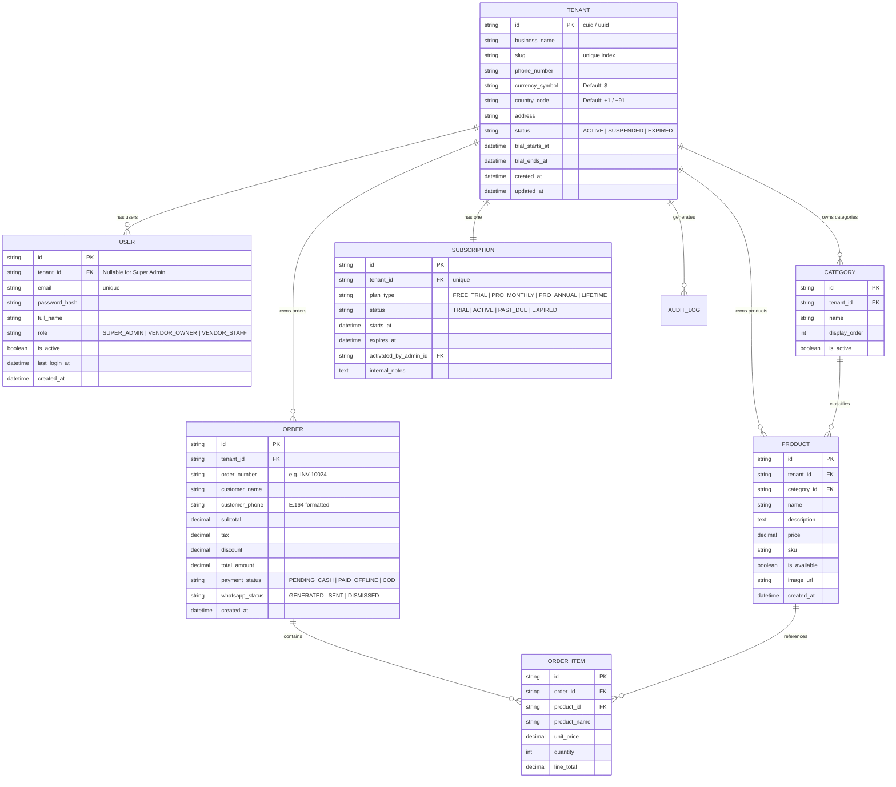
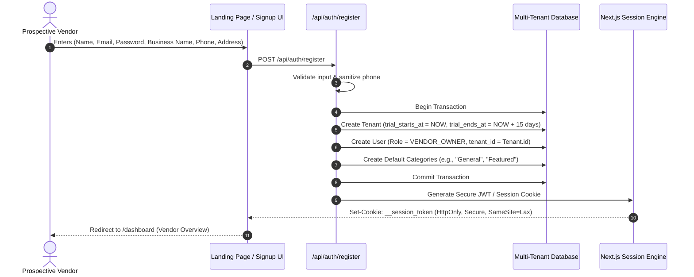
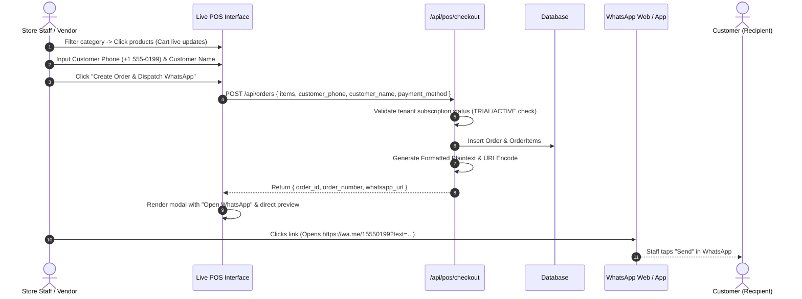
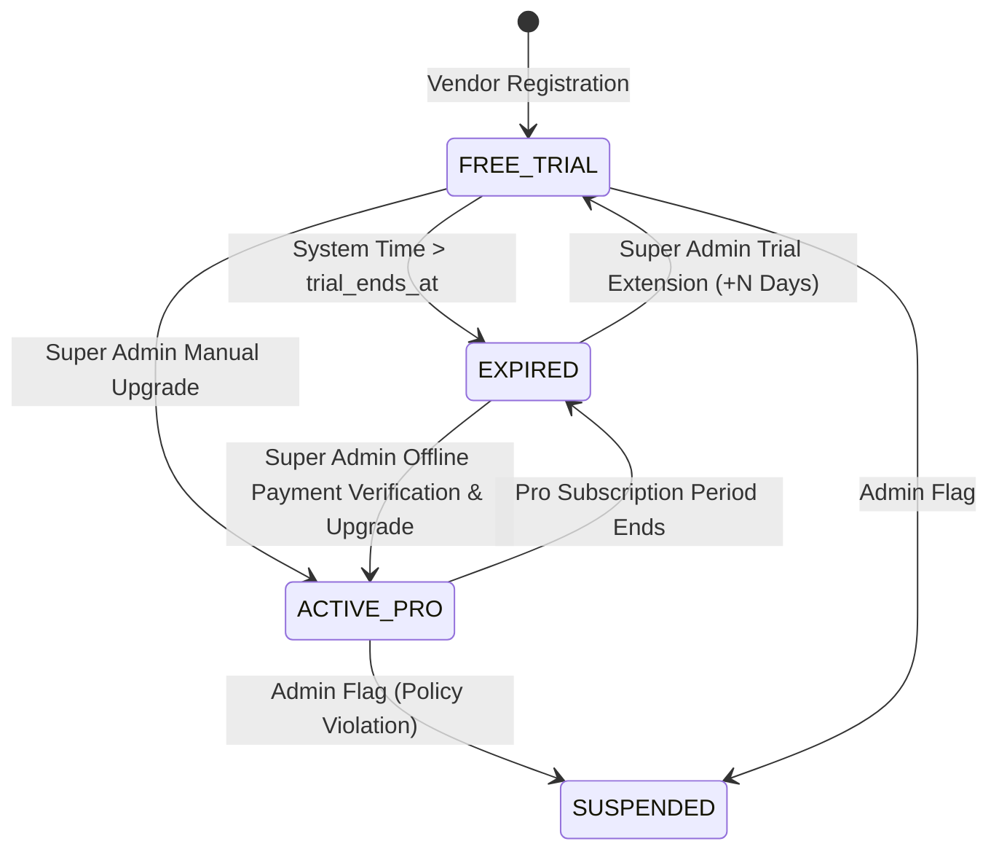

# Multi-Tenant Vendor Management & WhatsApp Ordering SaaS
## Comprehensive System Architecture & Engineering Documentation

---

### 1. Executive Summary & Core Objectives

The **Multi-Tenant Vendor Management & WhatsApp Ordering SaaS** is a cloud-native, multi-tenant B2B platform engineered for rapid-turnaround merchants, service shops, boutique retailers, pop-up stalls, and restaurant/cafe operators. 

#### Core Value Proposition
- **Frictionless Zero-Gateway Checkout**: Eliminates dependency on expensive, complex merchant payment gateways (Stripe, Razorpay, etc.) during initial business validation.
- **Instant WhatsApp Dispatch Engine**: Generates deterministic, pre-formatted, highly legible digital receipts with one-click direct dispatch to customer WhatsApp chats (`https://wa.me/<phone>?text=<encoded_payload>`).
- **Strict Multi-Tenant Isolation**: Hard boundaries per tenant (`tenant_id`) ensuring catalog items, categories, sales logs, and customer contacts remain strictly private and sandboxed.
- **Automated 15-Day Trial Engine with Admin-Managed Paywall**: Automatically provisions a 15-day evaluation period at registration. Transitions into a locked paywall state upon expiration with Super Admin manual upgrade/extension controls.

---

### 2. High-Level System Architecture

```mermaid
graph TD
    subgraph Client Tier
        C1["Customer / Buyer (Receives WhatsApp Receipt)"]
        V1["Vendor Dashboard & Live POS (Mobile / Desktop Web)"]
        A1["Super Admin Oversight Console"]
    end

    subgraph Edge & Routing Tier (Next.js / Edge Middleware)
        MW["Edge Middleware / Auth Guards"]
        AUTH["Session / JWT Validation"]
        PAYWALL["Trial & Paywall Evaluator (15-day rule)"]
    end

    subgraph Application Tier (Next.js Server Actions / Route Handlers)
        R_AUTH["/api/auth (Login / Register Tenant)"]
        R_CAT["/api/catalog (Categories & Products)"]
        R_POS["/api/pos (Orders & Cart Engine)"]
        R_WA["WhatsApp Formatter Service"]
        R_ADMIN["/api/admin (Super Admin Controls)"]
    end

    subgraph Data & Storage Tier
        DB[("PostgreSQL / SQLite Multi-Tenant DB")]
        CACHE[("Session & Tenant State Cache")]
    end

    V1 -->|HTTPS| MW
    A1 -->|HTTPS| MW
    MW --> AUTH
    AUTH --> PAYWALL
    PAYWALL -->|Authorized| Application Tier
    PAYWALL -->|Expired| V1_LOCKED["Paywall Screen (Contact Admin)"]

    R_POS --> R_WA
    R_WA -->|wa.me deep link| C1

    Application Tier --> DB
    Application Tier --> CACHE
```

---

### 3. Role-Based Access Control (RBAC) Architecture

| Permission / Action | Super Admin | Vendor (Owner / Staff) | Unauthenticated User |
| :--- | :---: | :---: | :---: |
| **Browse Landing Page & Public Docs** | ✅ | ✅ | ✅ |
| **Register New Business (Start 15-Day Trial)** | ❌ (Global Admin) | ✅ (Creates Tenant) | ✅ |
| **Login to Dashboard** | ✅ (Admin Portal) | ✅ (Tenant Portal) | ❌ |
| **Manage Catalog (Categories & Products)** | Global Audit View | ✅ (Own Tenant Only) | ❌ |
| **Access POS & Record Transactions** | Global Audit View | ✅ (Own Tenant Only) | ❌ |
| **Generate WhatsApp Formatted Receipts** | Global Audit View | ✅ (Own Tenant Only) | ❌ |
| **View Analytics & Revenue Metrics** | System-Wide Aggregates | ✅ (Tenant Metrics Only) | ❌ |
| **Manual Pro Activation / Trial Extension** | ✅ (Any Tenant) | ❌ | ❌ |
| **Suspend / Reactivate Tenant Account** | ✅ | ❌ | ❌ |
| **Impersonate Tenant for Troubleshooting** | ✅ (Audited) | ❌ | ❌ |

---

### 4. Multi-Tenant Relational Data Model (Schema Design)

The database enforces multi-tenancy at the relational level via a composite foreign key index strategy ensuring no cross-tenant data leaks.



---

### 5. Detailed User Journeys & Website Flow

#### A. New Vendor Registration & Provisioning Flow


#### B. POS Order Generation & WhatsApp Link Dispatch


---

### 6. WhatsApp Digital Receipt Formatter Specification

The WhatsApp dispatch system does not require third-party messaging API credentials (Twilio/Meta Cloud API) for base tier operations. Instead, it utilizes standard URI schemes compatible across desktop, iOS, and Android:

#### URI Generation Format
```text
https://wa.me/{clean_phone_number}?text={url_encoded_receipt_string}
```

#### Deterministic Formatting Template
```text
🧾 *RECEIPT: #{order_number}*
🏢 *{business_name}*
📅 {order_date_time}
👤 Customer: {customer_name}
────────────────────────────
{item_rows}
  • {item_name} x{quantity} @ {currency}{unit_price} = *{currency}{line_total}*
────────────────────────────
Subtotal: {currency}{subtotal}
Tax ({tax_rate}%): {currency}{tax}
*TOTAL AMOUNT: {currency}{total_amount}*
────────────────────────────
Payment: {payment_status_label}
📍 {business_address}
📞 Support: {business_phone}

_Thank you for your business!_
```

#### Phone Number Sanitization Rule
```typescript
export function sanitizeWhatsAppPhone(phone: string, defaultCountryCode: string = "1"): string {
  // Strip non-digits
  const digitsOnly = phone.replace(/\D/g, "");
  // Check if international code is already included
  if (digitsOnly.length === 10) {
    return `${defaultCountryCode}${digitsOnly}`;
  }
  return digitsOnly;
}
```

---

### 7. 15-Day Free Trial & Paywall Enforcement Engine

#### State Transition Logic


#### Middleware Guard Specification
```typescript
// middleware.ts (Next.js)
import { NextResponse } from 'next/server';
import type { NextRequest } from 'next/server';

export async function middleware(request: NextRequest) {
  const { pathname } = request.nextUrl;
  
  // Public assets and auth bypass
  if (pathname.startsWith('/_next') || pathname.startsWith('/api/auth') || pathname === '/' || pathname === '/login' || pathname === '/register') {
    return NextResponse.next();
  }

  const session = await getSession(request);
  if (!session) {
    return NextResponse.redirect(new URL('/login', request.url));
  }

  // Super Admin bypasses tenant paywall
  if (session.role === 'SUPER_ADMIN') {
    return NextResponse.next();
  }

  // Evaluate Tenant Trial Window
  const tenant = await getTenantById(session.tenantId);
  const now = new Date().getTime();
  const trialEnds = new Date(tenant.trialEndsAt).getTime();
  const isPaid = tenant.subscriptionStatus === 'ACTIVE';

  if (!isPaid && now > trialEnds) {
    // If attempting write API routes, reject with 403 Forbidden
    if (pathname.startsWith('/api/')) {
      return NextResponse.json(
        { error: 'TRIAL_EXPIRED', message: 'Your 15-day free trial has expired. Contact support to upgrade.' },
        { status: 403 }
      );
    }
    
    // Redirect to Paywall Screen if navigating dashboard
    if (pathname !== '/dashboard/paywall') {
      return NextResponse.redirect(new URL('/dashboard/paywall', request.url));
    }
  }

  return NextResponse.next();
}
```

---

### 8. Super Admin Administrative Controls

The Super Admin portal is an isolated management surface providing:
1. **Tenant Directory**:
   - Filter by status: `Trial Active`, `Trial Expired`, `Pro Member`, `Suspended`.
   - Days remaining countdown for active trials.
   - Total items in catalog, total orders processed, and gross merchandise volume (GMV).
2. **One-Click Actions**:
   - **Extend Trial**: Add +7, +15, or +30 days with optional audit note.
   - **Activate Pro**: Instant transition to paid state with expiration date picker.
   - **Suspend Tenant**: Immediate block on all logins and POS generation.
   - **Direct WhatsApp Outreach**: Quick link to WhatsApp chat with the merchant's registered phone number to discuss plans.

---

### 9. Production Technology Stack Recommendation

| Component | Recommended Technology | Rationale |
| :--- | :--- | :--- |
| **Framework** | Next.js 14+ (App Router) | Full-stack SSR, API Route Handlers, Edge Middleware |
| **Database** | SQLite (Local Dev) / PostgreSQL (Prod) | ACID compliance, robust foreign key constraints |
| **ORM / Query Engine**| Prisma or Drizzle ORM | Type-safe queries, migration control, schema declarative model |
| **Styling & UI** | Vanilla CSS / CSS Modules | Highly performant, custom-tailored luxury aesthetic, zero bloat |
| **Icons & Micro-animations** | Feather / Lucide SVG + CSS Keyframes | Instant rendering, touch-optimized POS buttons |
| **Security & Auth** | HTTP-Only Signed Cookies (JWT / Iron-Session) | Protection against XSS, multi-device resilience |

---

### 10. Implementation Roadmap

- **Phase 1**: Database schema & Seed data (Super Admin account, Demo Vendors, Sample Catalog).
- **Phase 2**: Authentication & Tenant registration engine with automated 15-day trial calculations.
- **Phase 3**: Vendor Catalog Management (Categories, Items, Stock/Availability toggles).
- **Phase 4**: Point of Sale (POS) Interface with instant cart calculations and WhatsApp Link Formatter.
- **Phase 5**: Paywall Enforcement (Edge middleware & UI Paywall notice with admin contacts).
- **Phase 6**: Super Admin Management Dashboard (Tenant oversight, one-click trial extensions, Pro activation).
